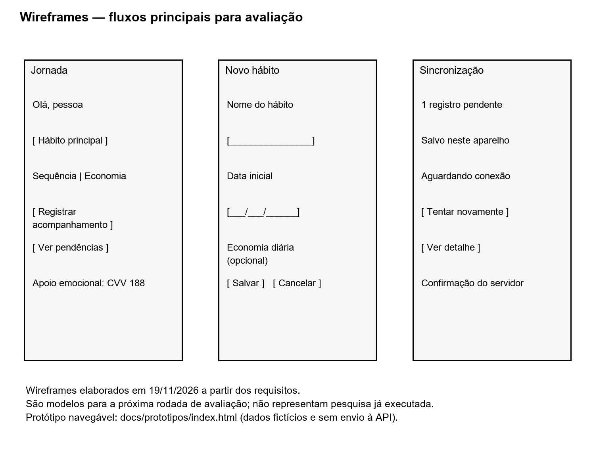

# Protótipos do REVIVE

Wireframes e protótipo navegável elaborados em 19/11/2026 para avaliação dos requisitos.
Não são evidência de pesquisa já realizada nem protótipos históricos anteriores ao aplicativo.

Abra [index.html](index.html) em um navegador. Os fluxos permitem criar um hábito fictício,
registrar acompanhamento, reconhecer uma pendência e simular sua confirmação.
Nenhum dado é enviado à API ou persistido. Recarregar reinicia a simulação.

