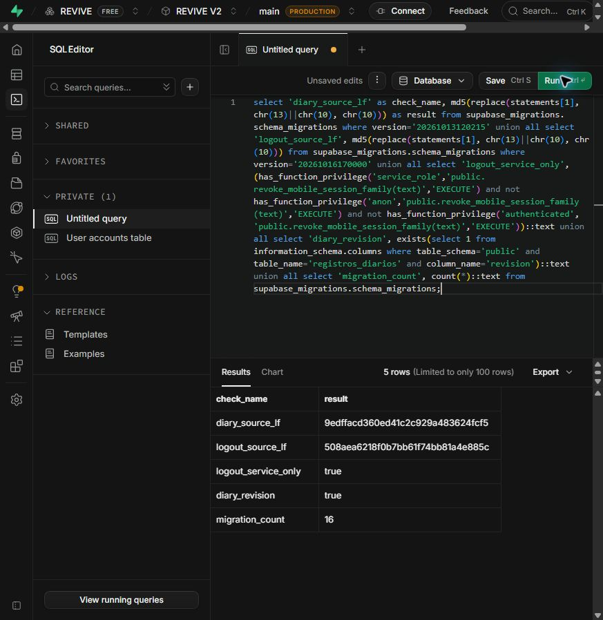

# Rollout autorizado das sessões web — 16/10/2026

O [PR #72](https://github.com/vitoradriao/revive/pull/72) integrou a [#57](https://github.com/vitoradriao/revive/issues/57) na main em `5ca7db48fe691d6cf78e1b50df99fd3251c7dbc8`. O usuário autorizou separadamente preparar banco/configuração, integrar e publicar.

## Ambiente e preparação

Projeto Vercel `revive` / `prj_AkmQVDVtFARtg04uHbIoxmdMn6IT`, domínio [revive-beryl.vercel.app](https://revive-beryl.vercel.app). O [registro anterior](../revive-mobile/docs/deployment-validation.md) identifica o banco REVIVE V2 `upqlaeqdaobzrepamnvs`; a configuração de endereço na Vercel ainda tinha atualização de 06/09. Esse vínculo foi inferido desses registros e metadados, pois SUPABASE_URL está marcada como segredo write-only.

A CLI Supabase estava sem sessão válida; o SQL foi aplicado pelo editor da sessão autenticada existente. O painel indicava ausência de backup gerenciado. As alterações transacionais foram preservadas como migrations aditivas, com histórico no mesmo commit SQL.

Aplicadas em ordem: `20261013120215_diary_record_edit` e `20261016170000_web_session_logout`. O histórico passou de 14 para 16 versões. Conferidos coluna revision e EXECUTE de logout: service_role permitido, anon/authenticated recusados. Os textos registrados coincidem com os arquivos versionados após normalizar CRLF para LF:

| Migration | MD5 do texto normalizado, sem newline final |
| --- | --- |
| 20261013120215 | 9edffacd360ed41c2c929a483624fcf5 |
| 20261016170000 | 508aea6218f0b7bb61f74bb81a4e885c |

A primeira tentativa de executar o segundo lote reapresentou o buffer anterior; PostgreSQL recusou a coluna já existente e a transação não avançou. O buffer foi substituído integralmente e o lote exclusivo foi confirmado. A verificação dos hashes confirmou também o texto integral armazenado no histórico.

## Publicação e smoke test

WEB_AUTH_ENABLED=true foi adicionada como Config exclusivamente em Production. O deployment GitHub `7129294104`, do commit acima, terminou em success. A integração havia passado todos os checks de API/painel/documentação, mobile e PostgreSQL 17. O [contrato e os testes locais](web-sessions.md) continuam sendo a evidência de sessão autenticada e concorrência.

| Consulta pública | Resultado confirmado |
| --- | --- |
| / e bundle do painel | 200, bundle contendo o transporte v2 |
| GET /api/health | 200 |
| GET /api/v2/bootstrap sem credencial | 401 |
| POST /api/v2/web-auth/login com objeto vazio | 422 DADOS_INVALIDOS |
| POST /api/v2/web-auth/refresh sem cookie, mesma origem | 401 REFRESH_AUSENTE; cookie de limpeza com HttpOnly, Secure, SameSite=Lax e Path correto |
| POST refresh com origem externa | 403 ORIGEM_INVALIDA |
| POST logout sem cookie | 204 sem corpo |

O smoke público não criou contas nem consultou dados pessoais. Ele comprova publicação e transporte básico, sem ampliar para homologação autenticada em produção, iOS/aparelho ou todos os navegadores. Offline durável segue na [#58](https://github.com/vitoradriao/revive/issues/58).
